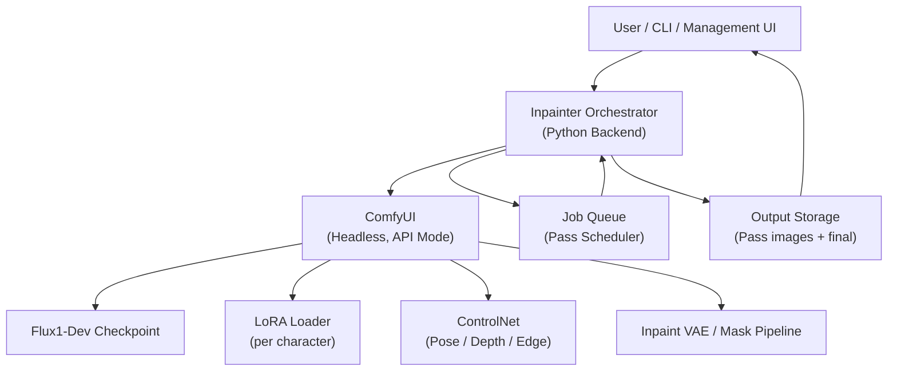
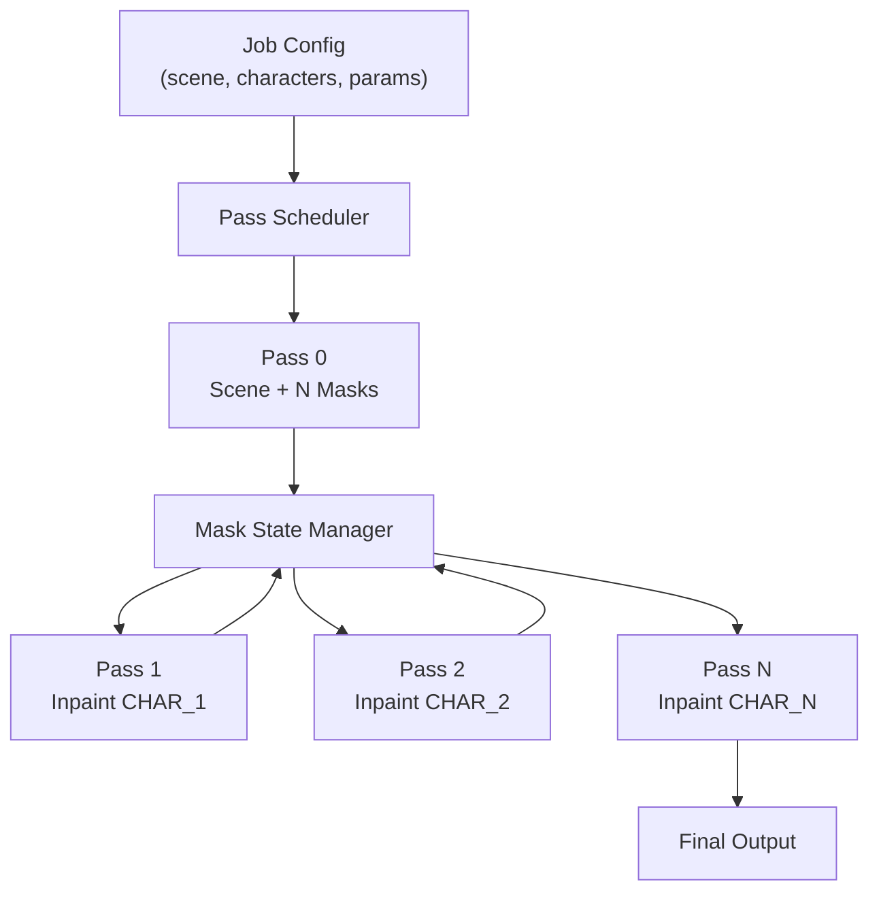
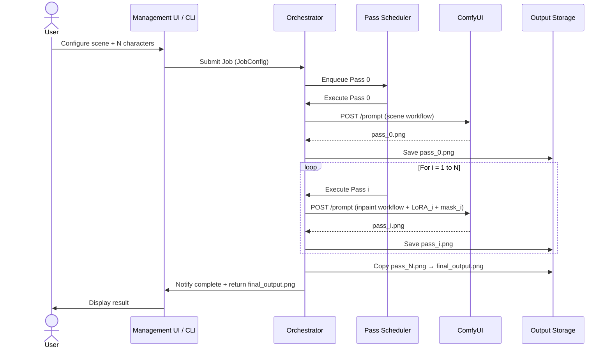

# Inpainter — Detailed Architecture

> N-Pass Multi-Character Inpainting Pipeline on ComfyUI

---

## System Overview



---

## Component Architecture

### 1. Management UI

A web-based control panel that serves as the primary interface for configuring and triggering generation jobs.

**Responsibilities:**
- Define the **scene prompt** (global description of environment, lighting, mood)
- Configure **N characters** with individual:
  - Character prompt (appearance, clothing, expression)
  - Character LoRA path and strength (optional)
  - ControlNet input (pose image, depth map, edge map — optional)
  - Mask placement / bounding box in scene
- Set **global generation parameters**: resolution, steps, CFG scale, sampler, scheduler, seed
- Trigger generation jobs and monitor pass-by-pass progress
- Preview intermediate outputs (after each pass)
- Download final composed image

---

### 2. CLI Tool

A command-line interface exposing all Management UI capabilities for scripting and automation.

```bash
# Example usage
inpainter generate \
  --scene "A cyberpunk alley at night, neon lights" \
  --character "name=Alice,prompt=woman in red jacket,lora=alice_v2.safetensors,lora_strength=0.8" \
  --character "name=Bob,prompt=man in grey coat,lora=bob_v1.safetensors,lora_strength=0.75" \
  --width 1024 --height 1024 \
  --steps 30 --cfg 7.0 \
  --output ./output/scene_01.png
```

**Key CLI flags:**
| Flag | Description |
|---|---|
| `--scene` | Global scene/background prompt |
| `--character` | Repeatable; defines one character (prompt, LoRA, ControlNet, mask) |
| `--n` | Number of characters (inferred from `--character` count) |
| `--model` | Base checkpoint path (default: Flux1-Dev) |
| `--controlnet` | ControlNet model path and type |
| `--steps` | Sampling steps per pass |
| `--cfg` | CFG guidance scale |
| `--seed` | Base seed (per-pass seeds derived from this) |
| `--output` | Output path for final image |
| `--save-intermediates` | Save images after each pass |

---

### 3. Inpainter Orchestrator (Backend)

The Python backend that coordinates the entire N-pass pipeline. It translates high-level job configurations into ComfyUI API calls, manages pass sequencing, mask state, and assembles the final image.



**Sub-components:**

| Component | Role |
|---|---|
| **Pass Scheduler** | Sequences Pass 0 → Pass N; manages dependencies between passes |
| **Mask State Manager** | Tracks which masks are active, generates binary mask images per pass |
| **Workflow Builder** | Dynamically constructs ComfyUI JSON workflow graphs per pass |
| **ComfyUI API Client** | Submits workflows, polls job status, retrieves images |
| **LoRA Injector** | Injects the character-specific LoRA node into the workflow for each pass |
| **ControlNet Injector** | Injects ControlNet conditioning node if pose/depth input is provided |
| **Image Compositor** | (Optional) post-processes and composites intermediate outputs |

---

### 4. ComfyUI (Headless)

ComfyUI runs in **API mode** with no browser UI. The Orchestrator communicates exclusively through its REST/WebSocket API.

- Endpoint: `http://localhost:8188`
- Workflow submission: `POST /prompt`
- Image retrieval: `GET /view?filename=...`
- Status: WebSocket `ws://localhost:8188/ws`

---

## N-Pass Pipeline — Detailed Flow

### Pass 0: Scene Generation with N Masks

**Goal:** Generate the base scene image establishing composition, background, lighting, and rough character positions — but with masked placeholder shapes instead of real characters.

**Inputs:**
- Scene prompt (global)
- N mask regions (bounding boxes or segmentation polygons)
- Base checkpoint (Flux1-Dev)
- Global generation params (resolution, steps, CFG, seed)

**Workflow nodes (ComfyUI graph):**
```
CheckpointLoader → CLIPTextEncode[scene_prompt] → KSampler
                                                       ↑
                                     [Mask compositor: N mask overlays baked into latent]
                                                       ↓
                                              VAEDecode → SaveImage[pass_0.png]
```

**Output:** `pass_0.png` — full scene with N clearly demarcated placeholder shapes.

---

### Pass 1 → N: Sequential Character Inpainting

For each character `i` in `1..N`:

**Goal:** Replace `MASK_i` with fully rendered `CHAR_i`, keeping all other regions pixel-perfect.

**Inputs:**
- Output image from previous pass (`pass_{i-1}.png`)
- Binary inpaint mask for `MASK_i` region only
- Character prompt for `CHAR_i`
- Character LoRA for `CHAR_i` (if available)
- ControlNet conditioning for `CHAR_i` (if pose/depth provided)
- Inpainting params (denoise strength, padding, blur)

**Workflow nodes (ComfyUI graph):**

```
CheckpointLoader
      ↓
LoRALoader[char_i_lora, strength]        ← Only for pass i
      ↓
CLIPTextEncode[scene_prompt + char_i_prompt]
      ↓
VAEEncodeForInpaint[pass_{i-1}.png, mask_i]
      ↓
ControlNetApply[pose_i / depth_i]        ← Optional
      ↓
KSamplerAdvanced[denoise=0.75..0.95]
      ↓
VAEDecode → SaveImage[pass_i.png]
```

**Key inpainting parameters:**

| Parameter | Recommended Range | Notes |
|---|---|---|
| Denoise strength | 0.75 – 0.95 | Lower = more faithful to existing scene |
| Mask padding | 16 – 32 px | Softens mask boundary |
| Mask blur | 4 – 12 px | Feathers edge for natural blending |
| Mask grow | 8 – 16 px | Expands mask slightly to avoid hard edges |
| LoRA strength | 0.6 – 0.9 | Per-character; tune for identity vs. style balance |

---

### Pass N Output: Final Image

After Pass N completes, `pass_N.png` is the final image containing all N consistent characters in the scene. The Orchestrator copies this as the canonical output.

---

## Mask Management Strategy

The mask for each character pass is a **binary image** (white = inpaint region, black = preserve):

```
Pass 1 mask:  ██░░░░  (only CHAR_1 slot is white)
Pass 2 mask:  ░░██░░  (only CHAR_2 slot is white)
Pass N mask:  ░░░░██  (only CHAR_N slot is white)
```

Mask generation strategies:
- **Bounding box**: Simple rectangular mask per character slot
- **Segmentation**: Semantic/manual polygon mask for irregular character shapes
- **Auto-segment**: Use SAM (Segment Anything Model) on Pass 0 output to auto-derive masks

---

## LoRA Application Strategy

| Pass | LoRA Applied |
|---|---|
| Pass 0 | None (scene generation, no character identity yet) |
| Pass 1 | `char_1.lora` (if provided) |
| Pass 2 | `char_2.lora` (if provided) |
| … | … |
| Pass N | `char_N.lora` (if provided) |

> [!IMPORTANT]
> Each pass loads **only the LoRA for the character being inpainted in that pass**. Applying multiple character LoRAs simultaneously causes identity blending and degrades consistency.

---

## ControlNet Integration

ControlNet is applied **per pass** at the character level:

- **Pose ControlNet (OpenPose)**: Provide a pose skeleton image per character to control body orientation and gesture.
- **Depth ControlNet**: Provide a depth map to control spatial placement and perspective.
- **Edge/Canny ControlNet**: Provide edge maps for fine structural control.

If a ControlNet input is not provided for a character, that pass skips ControlNet conditioning entirely.

---

## Data Flow Diagram



---

## Configuration Schema (Job Config)

```yaml
job:
  scene_prompt: "A cyberpunk alley at night, neon lights reflecting on wet ground"
  negative_prompt: "blurry, low quality, deformed"
  resolution:
    width: 1024
    height: 1024
  model:
    checkpoint: "flux1-dev.safetensors"
  sampler:
    name: "dpm_2m"
    scheduler: "karras"
    steps: 30
    cfg: 7.0
    seed: 42

  characters:
    - id: char_1
      name: "Alice"
      prompt: "young woman, red leather jacket, short dark hair, smiling"
      lora:
        path: "loras/alice_v2.safetensors"
        strength: 0.80
      controlnet:
        type: "openpose"
        image: "inputs/alice_pose.png"
        strength: 0.65
      mask:
        type: "bbox"
        x: 100
        y: 200
        width: 300
        height: 500

    - id: char_2
      name: "Bob"
      prompt: "middle-aged man, grey trenchcoat, beard, serious expression"
      lora:
        path: "loras/bob_v1.safetensors"
        strength: 0.75
      mask:
        type: "bbox"
        x: 600
        y: 180
        width: 320
        height: 530

  inpaint:
    denoise_strength: 0.85
    mask_padding: 24
    mask_blur: 8
    mask_grow: 12

  output:
    path: "./output/scene_01.png"
    save_intermediates: true
```

---

## Directory Structure

```
inpainter/
├── README.md
├── ARCHITECTURE.md
├── cli/
│   └── main.py               # CLI entry point
├── orchestrator/
│   ├── job.py                # Job config schema & loader
│   ├── scheduler.py          # Pass scheduler
│   ├── mask_manager.py       # Mask state management
│   ├── workflow_builder.py   # ComfyUI workflow JSON builder
│   ├── comfyui_client.py     # ComfyUI REST/WS API client
│   ├── lora_injector.py      # LoRA node injection
│   └── controlnet_injector.py # ControlNet node injection
├── ui/
│   ├── app.py                # Management UI backend (FastAPI / Flask)
│   └── frontend/             # Web frontend (React / plain HTML)
├── workflows/
│   ├── scene_base.json       # ComfyUI workflow template: Pass 0
│   └── inpaint_char.json     # ComfyUI workflow template: Pass 1..N
├── config/
│   └── defaults.yaml         # Default generation parameters
├── inputs/                   # Pose/depth/edge ControlNet inputs
├── output/                   # Generated images (intermediates + final)
└── tests/
    └── ...
```

---

## Consistency Guarantees

The N-pass architecture achieves character consistency through:

1. **Frozen background**: The mask for each pass covers only the target character's region. All other pixels are preserved exactly from the previous pass output.
2. **Per-character LoRA**: Each character's LoRA is active only during its own pass, preventing cross-contamination of identity features.
3. **Low denoise on character region**: A denoise strength below 1.0 ensures the character's inpainted region integrates with the scene's existing lighting and shadows.
4. **Shared scene conditioning**: The global scene prompt is included in every pass, anchoring each character to the same environment context.

---

## Limitations & Future Work

| Limitation | Mitigation / Roadmap |
|---|---|
| Characters must not heavily overlap | Use pose ControlNet to enforce non-overlapping body regions |
| Pass count scales linearly with N | Parallelization possible for non-overlapping regions |
| LoRA availability per character | Falls back gracefully to prompt-only conditioning |
| Mask bleeding at edges | Feathered masks + slight mask grow minimizes artifacts |
| Character lighting consistency | Depth/normal ControlNet or lighting-aware inpaint models |
| Long generation time for large N | Queue prioritization, async progress, incremental preview |
