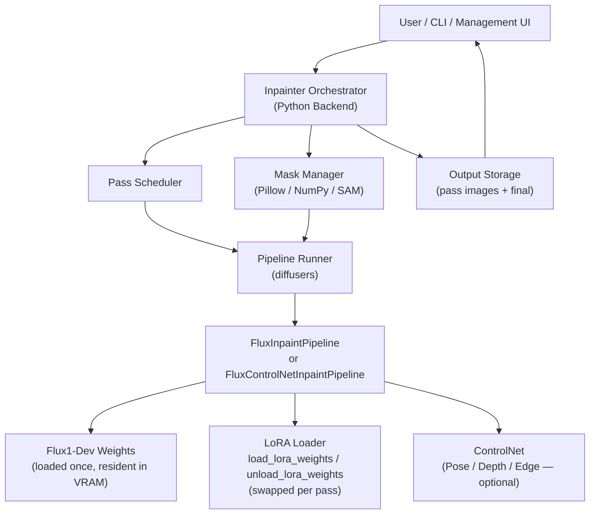
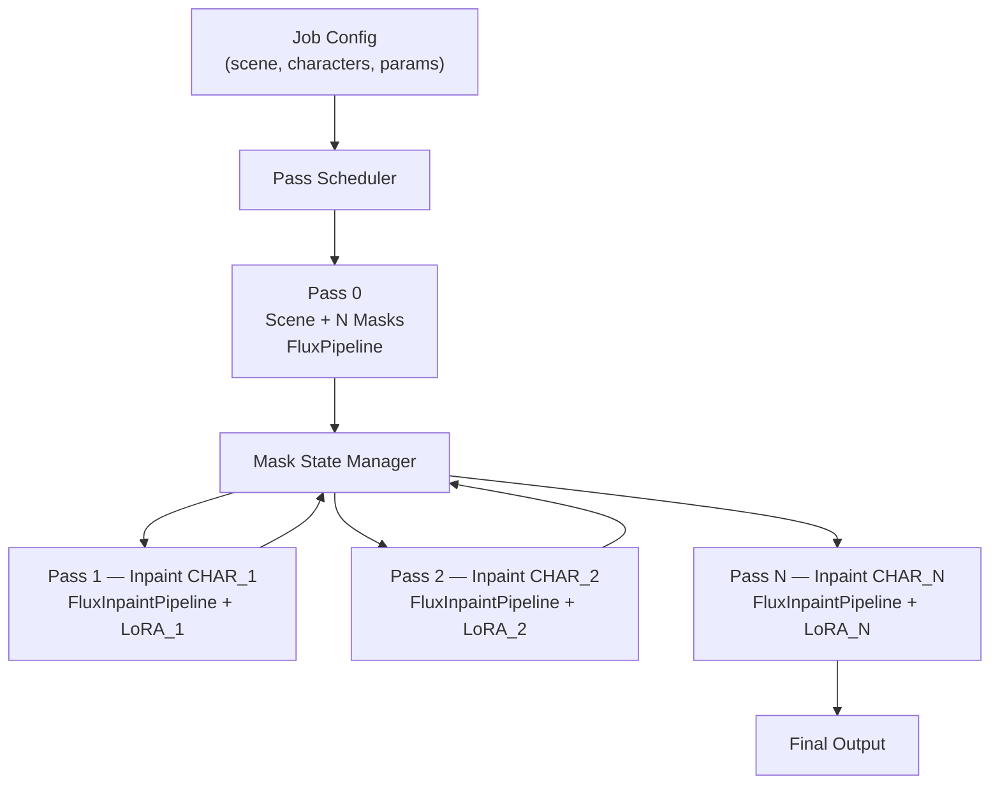
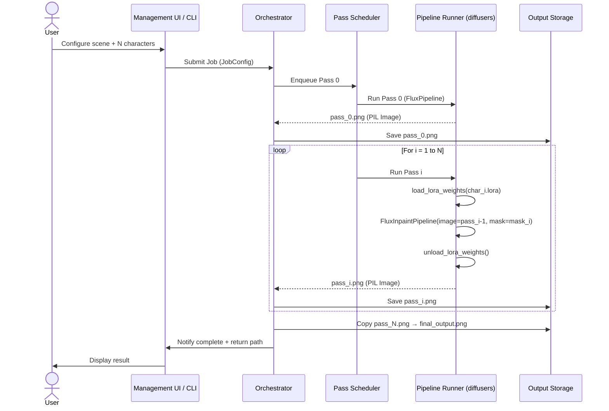

# Inpainter — Detailed Architecture

> N-Pass Multi-Character Inpainting Pipeline using Hugging Face `diffusers`

---

## System Overview



---

## Component Architecture

### 1. Management UI

A web-based control panel built on **FastAPI** + a lightweight frontend.

**Responsibilities:**
- Define the **scene prompt** (global description of environment, lighting, mood)
- Configure **N characters** with individual:
  - Character prompt (appearance, clothing, expression)
  - Character LoRA path and strength (optional)
  - ControlNet input — pose image, depth map, or edge map (optional)
  - Mask placement: bounding box or polygon
- Set **global generation parameters**: resolution, steps, CFG scale, sampler, scheduler, seed
- Trigger generation jobs and monitor pass-by-pass progress via SSE / WebSocket
- Preview intermediate outputs after each pass
- Download the final composed image

---

### 2. CLI Tool

A command-line interface built with **`typer`** or **`click`**, exposing all pipeline capabilities.

```bash
# Example usage
inpainter generate \
  --scene "A cyberpunk alley at night, neon lights" \
  --character "name=Alice,prompt=woman in red jacket,lora=loras/alice_v2.safetensors,lora_strength=0.8" \
  --character "name=Bob,prompt=man in grey coat,lora=loras/bob_v1.safetensors,lora_strength=0.75" \
  --width 1024 --height 1024 \
  --steps 30 --cfg 3.5 \
  --output ./output/scene_01.png \
  --save-intermediates
```

**Key CLI flags:**
| Flag | Description |
|---|---|
| `--scene` | Global scene/background prompt |
| `--character` | Repeatable; defines one character (prompt, LoRA, ControlNet, mask) |
| `--model` | Base model path or HF repo ID (default: `black-forest-labs/FLUX.1-dev`) |
| `--controlnet` | ControlNet model path/repo and type per character |
| `--steps` | Sampling steps per pass |
| `--cfg` | Guidance scale (CFG) |
| `--seed` | Base seed; per-pass seeds derived from this |
| `--output` | Output path for final image |
| `--save-intermediates` | Save `pass_0.png` through `pass_N.png` |
| `--device` | Torch device (`cuda`, `cpu`, `mps`) |
| `--dtype` | Model dtype (`float16`, `bfloat16`) |

---

### 3. Inpainter Orchestrator (Backend)

The Python backend that coordinates the entire N-pass pipeline. It manages pass sequencing, mask state, LoRA swapping, and ControlNet injection — all in-process via `diffusers`.



**Sub-components:**

| Component | Role |
|---|---|
| **Pass Scheduler** | Sequences Pass 0 → Pass N; manages inter-pass image handoff |
| **Pipeline Runner** | Wraps `diffusers` pipeline calls; handles LoRA load/unload lifecycle |
| **Mask State Manager** | Tracks active masks, generates binary PIL mask images per pass |
| **LoRA Manager** | Calls `pipe.load_lora_weights()` before each character pass, `pipe.unload_lora_weights()` after |
| **ControlNet Manager** | Conditionally switches between `FluxInpaintPipeline` and `FluxControlNetInpaintPipeline` |
| **Image Compositor** | (Optional) post-processes and composites intermediate pass outputs |

---

### 4. Pipeline Runner — `diffusers` Integration

The model is loaded **once** at startup and kept resident in VRAM. LoRAs are swapped per pass. This avoids costly model reloads between passes.

#### Model Load (startup)

```python
from diffusers import FluxInpaintPipeline
import torch

pipe = FluxInpaintPipeline.from_pretrained(
    "black-forest-labs/FLUX.1-dev",
    torch_dtype=torch.bfloat16,
).to("cuda")

# Optional: memory efficiency
pipe.enable_model_cpu_offload()
pipe.enable_vae_tiling()
```

#### Pass 0 — Scene Generation

```python
from diffusers import FluxPipeline

scene_pipe = FluxPipeline.from_pretrained(
    "black-forest-labs/FLUX.1-dev",
    torch_dtype=torch.bfloat16,
).to("cuda")

# Prompt includes description of N masked silhouette areas
scene_image = scene_pipe(
    prompt=scene_prompt_with_masks,
    width=width,
    height=height,
    num_inference_steps=steps,
    guidance_scale=cfg,
    generator=torch.Generator().manual_seed(seed),
).images[0]

scene_image.save("pass_0.png")
```

#### Pass i — Character Inpainting (with LoRA)

```python
# Load character LoRA for this pass
if char_i.lora_path:
    pipe.load_lora_weights(char_i.lora_path, adapter_name=f"char_{i}")
    pipe.set_adapters([f"char_{i}"], adapter_weights=[char_i.lora_strength])

result = pipe(
    prompt=f"{scene_prompt}, {char_i.prompt}",
    image=prev_pass_image,          # PIL Image from pass i-1
    mask_image=mask_i,              # Binary PIL mask (white = inpaint)
    width=width,
    height=height,
    num_inference_steps=steps,
    strength=denoise_strength,      # 0.75 – 0.95
    guidance_scale=cfg,
    generator=torch.Generator().manual_seed(seed + i),
).images[0]

# Unload LoRA before next pass
if char_i.lora_path:
    pipe.unload_lora_weights()

result.save(f"pass_{i}.png")
```

#### Pass i — With ControlNet (optional)

```python
from diffusers import FluxControlNetInpaintPipeline, FluxControlNetModel

controlnet = FluxControlNetModel.from_pretrained(
    "InstantX/FLUX.1-dev-Controlnet-Union",
    torch_dtype=torch.bfloat16,
)

cn_pipe = FluxControlNetInpaintPipeline.from_pretrained(
    "black-forest-labs/FLUX.1-dev",
    controlnet=controlnet,
    torch_dtype=torch.bfloat16,
).to("cuda")

result = cn_pipe(
    prompt=f"{scene_prompt}, {char_i.prompt}",
    image=prev_pass_image,
    mask_image=mask_i,
    control_image=char_i.controlnet_image,   # Pose / depth / edge PIL image
    controlnet_conditioning_scale=char_i.controlnet_strength,
    num_inference_steps=steps,
    strength=denoise_strength,
    guidance_scale=cfg,
).images[0]
```

---

## N-Pass Pipeline — Detailed Flow

### Pass 0: Scene Generation with N Masks

**Goal:** Generate the base scene establishing composition, background, and lighting — with N clearly demarcated placeholder regions for each character.

**Strategy for mask placeholders (choose one):**
- **Prompt-based**: Include `[silhouette of person 1]`, `[silhouette of person 2]` in the scene prompt to let the model generate natural placeholder shapes.
- **Baked overlay**: Composite N solid-colour rectangles or ellipses onto a neutral canvas and use it as the `image` input for a low-strength inpaint pass.
- **Text-to-image then mask**: Run a standard `FluxPipeline` generate, then use SAM or manual bounding boxes to identify and record mask regions from the output.

**Output:** `pass_0.png` — full scene with N clearly demarcated placeholder shapes.

---

### Pass 1 → N: Sequential Character Inpainting

For each character `i` in `1..N`:

**Goal:** Replace `MASK_i` with fully rendered `CHAR_i`, keeping all other regions pixel-perfect.

**Inputs:**
- `pass_{i-1}.png` — output image from previous pass
- Binary inpaint mask covering only `MASK_i` region
- Character prompt for `CHAR_i`
- Character LoRA path + strength (optional)
- ControlNet conditioning image (optional)

**Key inpainting parameters:**

| Parameter | Recommended Range | Notes |
|---|---|---|
| `strength` (denoise) | 0.75 – 0.95 | Lower = preserves more of existing scene |
| Mask padding | 16 – 32 px | Softens mask boundary |
| Mask blur (`GaussianBlur`) | 4 – 12 px | Feathers edge for natural blending |
| Mask grow (dilate) | 8 – 16 px | Expands mask slightly to avoid hard edges |
| LoRA strength | 0.6 – 0.9 | Tune per character for identity vs. style balance |

---

### Pass N Output: Final Image

After Pass N, `pass_N.png` is the final image containing all N consistent characters. It is copied to the user-specified output path.

---

## Mask Management Strategy

Each pass uses a **binary PIL mask** (`mode="L"`, white = inpaint, black = preserve):

```
Pass 1 mask:  ██░░░░  (only CHAR_1 slot is white)
Pass 2 mask:  ░░██░░  (only CHAR_2 slot is white)
Pass N mask:  ░░░░██  (only CHAR_N slot is white)
```

**Mask generation with Pillow:**
```python
from PIL import Image, ImageFilter
import numpy as np

def make_mask(width, height, bbox, padding=24, blur=8, grow=12):
    mask = Image.new("L", (width, height), 0)
    x, y, w, h = bbox
    # Grow the region
    region = (x - grow, y - grow, x + w + grow, y + h + grow)
    mask.paste(255, region)
    # Blur edges
    mask = mask.filter(ImageFilter.GaussianBlur(radius=blur))
    return mask
```

**Auto-segmentation (optional):** Use SAM (Segment Anything Model) on `pass_0.png` to automatically derive character masks from the generated placeholder regions.

---

## LoRA Application Strategy

| Pass | LoRA Applied |
|---|---|
| Pass 0 | None — scene generation only |
| Pass 1 | `char_1.lora` via `pipe.load_lora_weights()` |
| Pass 2 | `char_2.lora` via `pipe.load_lora_weights()` |
| … | … |
| Pass N | `char_N.lora` via `pipe.load_lora_weights()` |

> [!IMPORTANT]
> Each pass loads **only the LoRA for the character being inpainted**. The LoRA is unloaded with `pipe.unload_lora_weights()` immediately after the pass completes. Applying multiple character LoRAs simultaneously causes identity blending and degrades consistency.

---

## ControlNet Integration

ControlNet is applied **per pass** at the character level. The Pipeline Runner conditionally switches between:

- `FluxInpaintPipeline` — no ControlNet (default)
- `FluxControlNetInpaintPipeline` — when a character has ControlNet input

**Supported ControlNet types per character:**

| Type | Input | Use Case |
|---|---|---|
| OpenPose | Pose skeleton image | Control body orientation and gesture |
| Depth | Depth map | Control spatial placement and perspective |
| Canny / Edge | Edge map | Fine structural / clothing detail control |

If no ControlNet input is provided for a character, that pass uses the base `FluxInpaintPipeline`.

---

## Data Flow Diagram



---

## Configuration Schema (Job Config)

```yaml
job:
  scene_prompt: "A cyberpunk alley at night, neon lights reflecting on wet ground"
  negative_prompt: "blurry, low quality, deformed"
  resolution:
    width: 1024
    height: 1024
  model:
    repo_id: "black-forest-labs/FLUX.1-dev"   # or local path
    dtype: "bfloat16"
    device: "cuda"
  sampler:
    steps: 30
    cfg: 3.5
    seed: 42

  characters:
    - id: char_1
      name: "Alice"
      prompt: "young woman, red leather jacket, short dark hair, smiling"
      lora:
        path: "loras/alice_v2.safetensors"
        strength: 0.80
      controlnet:
        type: "openpose"
        image: "inputs/alice_pose.png"
        strength: 0.65
      mask:
        type: "bbox"
        x: 100
        y: 200
        width: 300
        height: 500

    - id: char_2
      name: "Bob"
      prompt: "middle-aged man, grey trenchcoat, beard, serious expression"
      lora:
        path: "loras/bob_v1.safetensors"
        strength: 0.75
      mask:
        type: "bbox"
        x: 600
        y: 180
        width: 320
        height: 530

  inpaint:
    strength: 0.85
    mask_padding: 24
    mask_blur: 8
    mask_grow: 12

  output:
    path: "./output/scene_01.png"
    save_intermediates: true
```

---

## Directory Structure

```
inpainter/
├── README.md
├── ARCHITECTURE.md
├── pyproject.toml              # Dependencies: diffusers, transformers, torch, Pillow, typer, fastapi
├── cli/
│   └── main.py                 # CLI entry point (typer / click)
├── orchestrator/
│   ├── job.py                  # Job config schema & loader (Pydantic)
│   ├── scheduler.py            # Pass scheduler (sequences Pass 0 → N)
│   ├── mask_manager.py         # Binary mask generation (Pillow / NumPy / SAM)
│   ├── pipeline_runner.py      # diffusers pipeline wrapper (FluxInpaintPipeline)
│   ├── lora_manager.py         # load_lora_weights / unload_lora_weights lifecycle
│   └── controlnet_manager.py   # Conditional ControlNet pipeline selection
├── ui/
│   ├── app.py                  # FastAPI backend (REST + SSE progress)
│   └── frontend/               # Web frontend (HTML/JS or React)
├── config/
│   └── defaults.yaml           # Default generation parameters
├── inputs/                     # Pose/depth/edge ControlNet inputs
├── output/                     # Generated images (intermediates + final)
└── tests/
    └── ...
```

---

## Python Dependencies

```toml
[project]
dependencies = [
    "diffusers>=0.30.0",
    "transformers>=4.44.0",
    "accelerate>=0.33.0",
    "torch>=2.3.0",
    "Pillow>=10.0.0",
    "numpy>=1.26.0",
    "pyyaml>=6.0",
    "typer>=0.12.0",         # CLI
    "fastapi>=0.112.0",      # Management UI backend
    "uvicorn>=0.30.0",       # ASGI server
    "pydantic>=2.0.0",       # Job config validation
    # Optional:
    # "segment-anything>=1.0"  # SAM auto-mask
    # "controlnet-aux>=0.0.9"  # Pose/depth preprocessors
]
```

---

## Consistency Guarantees

The N-pass architecture achieves character consistency through:

1. **Frozen background** — Each pass mask covers only the target character's slot. All other pixels are preserved exactly from the previous pass via `diffusers`' inpaint masking.
2. **Per-character LoRA isolation** — Each character's LoRA is active only during its pass. It is fully unloaded before the next pass via `pipe.unload_lora_weights()`.
3. **Controlled denoise strength** — `strength < 1.0` ensures the inpainted character integrates with the scene's existing lighting and shadows.
4. **Shared scene conditioning** — The global scene prompt is prepended to every character pass prompt, anchoring all characters to the same environment context.

---

## Limitations & Future Work

| Limitation | Mitigation / Roadmap |
|---|---|
| Characters must not heavily overlap | Use pose ControlNet to enforce non-overlapping body positions |
| Pass count scales linearly with N | Parallelization possible for spatially non-overlapping regions |
| LoRA availability per character | Falls back to prompt-only conditioning if LoRA not provided |
| Mask boundary artifacts | Feathered masks (`GaussianBlur`) + mask grow minimizes edge bleed |
| Character lighting consistency | Depth/normal ControlNet or lighting-aware inpaint models |
| Long generation time for large N | Async job queue, incremental pass previews, `torch.compile` for speedup |
| VRAM pressure with ControlNet | `enable_model_cpu_offload()` + `enable_vae_tiling()` on constrained GPUs |
